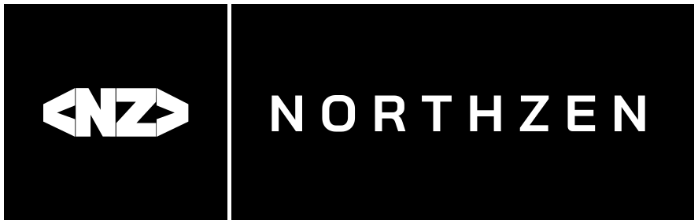

<p align="center">
  
</p>

# NZ

**NZ** (North Zen) is a memory-safe systems programming language with no garbage collector by default. Its syntax is close to C#, its memory model is based on ownership and borrowing, and its compiler translates programs to C.

> **Status: Experimental.** Version `0.0.0-dev`. The language is changing. This repository holds the language documentation only; the compiler source is not public yet. Supported platform for now: Linux x86_64.

```nz
package main;

import std.io.Console;

void Main(string[] args) {
    Console.WriteLine("Hello, NZ");
}
```

## Why NZ

- **Memory safe without a GC.** Ownership and borrowing are checked at compile time.
- **Readable.** C# syntax: `class`, `struct`, `interface`, generics, properties, `var`.
- **Visibility from the name.** `Add` is visible outside its package, `add` is local.
- **No surprise nulls.** `null` is valid only for optional types (`T?`), and a `T?` must be checked before use.
- **Layered memory model.** No GC at the core, opt-in `Arc<T>` for shared data.

## Documentation

- [Language guide](docs/README.md): the full tour of the language. Every `nz` code block in it is checked by the real compiler.
- [Syntax reference](docs/+/Syntax-Reference.md): every construct with its syntax, an example, its status and how it differs from C#
- [Ownership](docs/+/Ownership.md), [Memory model](docs/+/Memory-Model.md), [Null safety](docs/+/Null-Safety.md)
- [Standard library](docs/+/Standard-Library.md), which follows .NET names and behaviour
- [Compiler notes](docs/+/Compiler.md) and [Compiler API](docs/+/Compiler-API.md)

These pages are published from the development repository after each milestone of work, so they describe what the compiler does today.

## License

Apache License 2.0, see [LICENSE](LICENSE). Programs you compile with NZ are yours, under any license you choose. The name "NZ" and its logos are not covered by that license.
